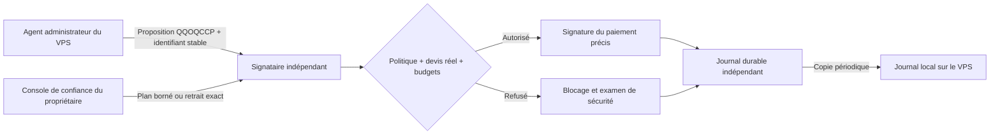

# Portefeuille autonome avec signataire indépendant

Le garde-fou crypto est **optionnel et désactivé tant qu'aucun `walletGuardian`
n'est configuré**. Cette modification ne déplace aucun fonds, n'augmente aucun
plafond existant, n'installe aucun service sur le VPS et ne sécurise pas
rétroactivement son portefeuille d'identité.

## Limite qui détermine l'architecture

Un agent administrateur du VPS peut lire les clés présentes sur ce VPS,
remplacer son programme et contourner une vérification locale. Une seconde
réflexion du modèle, un compte supplémentaire, un conteneur ou un journal local
sur ce même hôte ne constituent pas une séparation contre root.

Le signataire doit donc fonctionner sur **un autre hôte de confiance** que
l'agent ne peut ni administrer ni atteindre avec des identifiants
d'administration. Sa nouvelle clé privée reste sur cet hôte. Le VPS ne reçoit
qu'un jeton client limité aux opérations de la politique. Ne pas lui transmettre
les clés SSH d'administration du signataire, ni une sauvegarde de son portefeuille.
Un ordinateur personnel peut héberger le signataire, mais ses périodes d'arrêt
interrompent les paiements autonomes. Une disponibilité permanente demande un
hôte de confiance disponible en permanence.



Le portefeuille d'identité existant reste utilisable pour l'identité de l'agent.
**Il doit rester sans fonds.** Le nouveau portefeuille de financement doit être
différent : connecter son ancienne clé à un serveur distant ne la retire pas
des fichiers, sauvegardes ou de la mémoire du VPS.

## Décisions prévues

| Demande | Contrôle et résultat |
| --- | --- |
| Retrait vers le MetaMask initial | QQOQCCP et autorisation exacte depuis la console indépendante : destinataire, réseau, actif, montant et frais maximaux liés au hash de la demande. Autorisation de 15 minutes et à usage unique. |
| Retrait vers un autre portefeuille | Blocage, notification et consigne d'examiner la source et les permissions. Une affirmation « le propriétaire l'a demandé » n'accorde aucun droit. |
| Achat d'un service utile au plan | Autonome après approbation initiale d'une mission bornée. Vérification du devis x402 réel, du domaine, de l'étape, des hypothèses citées, de la cohérence revenu/coût et des budgets avant signature. Notification durable avant signature. |

L'authentification de la demande de retrait est nécessaire **même pour le
MetaMask connu** : une injection pourrait autrement inventer une demande du
propriétaire. L'approbation initiale d'un plan permet ensuite ses achats autorisés
sans validation humaine pour chaque achat.

QQOQCCP contient un **résumé de décision vérifiable**, pas le raisonnement privé
du modèle : qui, quoi, où, quand, comment, combien, pourquoi, référence de la
source, mission/étape approuvée, décision parente éventuelle et hypothèses
économiques. `qui` et `sourceEventId` sont des déclarations à auditer, jamais une
preuve d'identité. L'autorité vient de l'approbation stockée par la console.
L'historique conserve le hash de la version approuvée du plan.

Les recettes estimées doivent dépasser le coût estimé, qui doit inclure les
dépenses déjà autorisées de la mission. Les hypothèses doivent citer les éléments
examinés dans le plan approuvé. **Ces contrôles ne prouvent pas la rentabilité**,
la qualité des données ni le paiement futur d'un client. Le signataire ne laisse
pas le modèle créer lui-même ses preuves d'autorisation.

## Préparer l'hôte de confiance

Utiliser une version revue du dépôt et son lockfile, avec Node 22 et pnpm
10.28.1. Les dépendances du signataire et l'administrateur de cet hôte restent de
confiance ; cette séparation ne prouve pas l'innocuité de toutes les dépendances.

```sh
pnpm install --frozen-lockfile
pnpm run build
node dist/wallet-guardian/cli.js help
```

Créer le compte de service `walletguardian`, puis initialiser un **nouveau**
répertoire privé depuis la console de confiance. Exemple à adapter sur cet
hôte uniquement, avec l'adresse MetaMask vérifiée indépendamment :

```sh
sudo node dist/wallet-guardian/cli.js init --directory /var/lib/wallet-guardian --owner ADRESSE_METAMASK
sudo chown -R walletguardian:walletguardian /var/lib/wallet-guardian
```

`init` refuse un répertoire déjà existant. Il crée une nouvelle clé EVM,
`guardian-policy.json`, un jeton client et affiche **uniquement les adresses
publiques**. Les fichiers privés sont en mode 0600, le répertoire en 0700.
Ne financer ce nouveau portefeuille qu'après installation et vérification.

Le service n'écoute qu'en `127.0.0.1:8787`. Utiliser un proxy HTTPS de confiance
avec un certificat vérifié. Exemple Caddy :

```caddyfile
wallet-guardian.example.com {
    reverse_proxy 127.0.0.1:8787
}
```

Restreindre l'entrée au VPS ou à un VPN de confiance et limiter les connexions
au niveau du proxy. Appliquer au signataire une politique réseau sortante qui
refuse les réseaux privés et les métadonnées cloud pour les achats publics.
La validation DNS applicative existante ne constitue pas un verrouillage au
point de connexion ; voir [la frontière réseau](network-security.md).

Le fichier [systemd d'exemple](../scripts/wallet-guardian.service.example) est à
adapter aux chemins Node/dépôt de cet hôte. Garder **une seule instance active**
par portefeuille. Les répertoires privés et le code du signataire ne doivent
jamais être montés dans le VPS administré par l'agent.

## Politique et budget de 10 €

Dans `guardian-policy.json`, l'initialisation prépare :

- 100 centimes USDC maximum par achat et 1 000 centimes USDC par heure ;
- 1 000 centimes **EUR** au total sur 24 heures glissantes ;
- aucune mission approuvée, aucun taux EUR supposé et une source de prix publique
  configurée explicitement : CoinGecko, paire USDC/EUR ;
- retraits ETH ou USDC canonique vers le seul propriétaire, sur Base uniquement
  par défaut, avec un plafond de frais natifs ;
- aucune signature de message arbitraire, approbation ERC-20, contrat
  personnalisable ou export de clé via l'API.

Les achats autonomes utilisent le protocole **x402 en USDC canonique sur Base**.
Un paiement arbitraire, un abonnement par carte ou l'usage d'un contrat complexe
n'est pas implémenté comme achat protégé. L'agent conserve ses fonctions de
travail et d'administration du VPS ; il ne reçoit pas de signature arbitraire
qui permettrait de contourner les limites de son portefeuille de financement.

Un euro n'est pas un USDC. Par défaut, `eurValuation: "coingecko"` récupère le
prix USDC/EUR par une requête GET HTTPS vers une URL fixe. Aucun jeton, adresse
de portefeuille ni contenu de mission n'est envoyé à cette source. Le modèle
ne choisit ni l'URL ni la valeur. Le prix est mis en cache pour dix minutes au
maximum, selon sa date de publication. La consultation n'est faite qu'en cas
de paiement qui nécessite un taux frais ; elle ne mobilise pas le modèle.
Il n'y a aucune conversion ou transaction de change automatique.

Si la source devient indisponible, un prix déjà vérifié reste utilisable jusqu'à
son échéance initiale. Ensuite les paiements sont suspendus, sans deviner un taux
et sans augmenter le plafond. L'agent peut continuer son travail sans paiement.
Cette source publique doit être revue et acceptée comme source de confiance
avant de financer le signataire ; aucune disponibilité permanente ni exactitude
absolue de ses données n'est garantie.

Le propriétaire peut aussi choisir une valorisation manuelle datée :

```json
{
  "dailyCurrency": "EUR",
  "dailyPaymentCents": 1000,
  "eurValuation": "manual",
  "eurQuote": {
    "eurPerUsdcMicros": "TAUX_EUR_PAR_USDC_MULTIPLIE_PAR_1000000",
    "validUntil": 0,
    "source": "Source et date de la valorisation vérifiée par l'opérateur"
  }
}
```

Ce fragment est volontairement **non activable** : remplacer le taux et
`validUntil` par leurs valeurs réelles. L'échéance est un timestamp en
millisecondes, au maximum 24 heures dans le futur en mode manuel. Sans taux valide,
les achats sont refusés. Le mode automatique évite ce renouvellement manuel
quotidien. Les montants sont comptés en entiers, arrondis au centime EUR supérieur
par achat. Le plafond est évalué avec les taux obtenus,
pas garanti contre une erreur de taux ou une variation de marché ultérieure.

Les budgets de mission et d'étape sont exprimés en centimes USDC. Les budgets
crypto sont distincts de la facturation Anthropic. `minimumUsdcReserveCents`
peut imposer une réserve USDC indépendante, avec solde vérifié ; la réserve locale
supplémentaire du runtime est également transmise. Après modification de la
politique JSON, **redémarrer le signataire**. Les missions sont lues en base à
chaque autorisation et peuvent être révoquées sans redémarrage.

## Approuver une mission une fois

Préparer sur l'hôte de confiance un fichier JSON examiné par le propriétaire :

```json
{
  "id": "rapport-client-1",
  "objective": "Produire le rapport commandé et vérifier sa livraison",
  "expiresAt": 0,
  "maxTotalCents": 300,
  "steps": [{
    "id": "donnees",
    "description": "Acheter les données manquantes pour le rapport",
    "maxTotalCents": 200,
    "allowedHosts": ["fournisseur.example"],
    "evidence": [{
      "id": "commande-client",
      "summary": "Commande et prix examinés par le propriétaire ; paiement futur encore incertain"
    }]
  }]
}
```

Remplacer l'expiration par une date future en millisecondes et le fournisseur
par un domaine réel. Un exemple de recette inventée n'est pas une preuve.
`allowedHosts` porte sur les domaines exacts. La valeur spéciale `"public"`
autorise la recherche et l'achat auprès de n'importe quel hôte public : elle
élargit le risque aux fournisseurs choisis par le modèle, dans les budgets
restants. Privilégier des domaines précis quand la mission le permet.
Chaque étape peut aussi fournir `allowedRecipients`, une liste d'adresses EVM
de commerçants vérifiées. Le signataire compare alors l'adresse du devis réel
à cette liste ; une liste vide interdit tout achat pour l'étape. Sans cette
option, l'adresse est celle du devis obtenu sur le domaine autorisé.

### Dépenses commerciales et opérationnelles

Chaque étape peut déclarer `spendKinds` : `["commercial"]` (valeur par défaut si
absent), `["operational"]` ou les deux. Le signataire refuse une dépense dont le
type n'a pas été approuvé par le propriétaire pour l'étape (`SPEND_KIND_NOT_APPROVED`).

| Type | `review.economics` exigé |
| --- | --- |
| `commercial` (défaut) | `expectedRevenueAtomic` > `estimatedPlanCostAtomic`, `evidenceIds` cités, `uncertainties`, `freeAlternative` |
| `operational` | `kind: "operational"`, `necessity` (nécessité pour la mission), `expectedBenefit`, `alternatives`, `estimatedPlanCostAtomic` ; `evidenceIds` et `uncertainties` facultatifs mais vérifiés s'ils sont fournis |

Une dépense opérationnelle n'exige **aucune recette** : ne pas en inventer. Dans
les deux cas restent obligatoires : QQOQCCP complet et récent, mission et étape
approuvées, domaine et commerçant autorisés, coût cumulé de la mission incluant
les dépenses déjà autorisées, budgets par achat, horaire, journalier (EUR),
mission et étape, et journalisation avant signature. Le type retenu figure dans
l'événement `service_authorized` (`spendKind`).

```sh
node dist/wallet-guardian/cli.js approve-goal --directory /var/lib/wallet-guardian --file /chemin/plan-revu.json
node dist/wallet-guardian/cli.js status --directory /var/lib/wallet-guardian
node dist/wallet-guardian/cli.js serve --directory /var/lib/wallet-guardian
```

Exécuter les commandes comme le compte autorisé de cet hôte. Avec systemd,
utiliser le service à la place de la dernière commande. Aucun endpoint HTTP
n'approuve de mission ou de retrait. Pour révoquer une mission :

```sh
node dist/wallet-guardian/cli.js revoke-goal --directory /var/lib/wallet-guardian --id rapport-client-1
```

La révocation bloque les nouvelles autorisations ; elle ne retire pas une
signature déjà transmise à un commerçant.

## Connecter le VPS de l'agent

Depuis une session d'administration du VPS, agent arrêté :

```sh
cd /opt/automaton
python3 scripts/configure-wallet-guardian.py
```

Le script demande l'origine HTTPS, les deux adresses publiques vérifiées, le
plafond local par achat et le **jeton client**, saisi sans affichage. Ne jamais
coller ce jeton, une clé privée ou une sauvegarde dans un chat. Les clés Claude,
le prompt initial et le portefeuille d'identité restent dans leur configuration
existante. Une sauvegarde privée et un nouveau fichier de jeton sont créés.
Le script ne contacte aucun service et ne change aucun plafond par défaut.
Un plafond local resté à zéro continue d'interdire les achats payants.

Au prochain démarrage, le runtime vérifie les adresses épinglées. En mode
guardian, `x402_fetch` passe exclusivement par le signataire. Une panne ne
déclenche **aucun repli sur une signature locale**. Le travail sans paiement
peut continuer si le signataire est indisponible. Les anciennes recharges
locales automatiques sont désactivées car elles n'ont pas de plan approuvé ;
un achat protégé du même service peut être demandé via x402 avec QQOQCCP.
Le jeton ne peut ni approuver un retrait, ni augmenter un budget, ni accéder à
la clé privée.

## Retrait et notifications

L'agent propose un retrait avec `wallet_withdraw`. Sur la console indépendante,
inspecter la demande complète, son montant, son réseau, son actif, ses frais et
son origine avant de copier son hash exact :

```sh
node dist/wallet-guardian/cli.js inspect --directory /var/lib/wallet-guardian --id IDENTIFIANT
node dist/wallet-guardian/cli.js approve-withdrawal --directory /var/lib/wallet-guardian --id IDENTIFIANT --hash HASH_VERIFIE --recipient ADRESSE_METAMASK
```

Cette commande approuve, sans transférer. L'agent peut ensuite appeler
`wallet_execute_withdrawal`. Le signataire ne construit qu'un transfert ETH
natif ou USDC canonique sur le réseau autorisé, avec les paramètres approuvés.
Il persiste le hash **avant** diffusion. Diffusion n'est pas confirmation.

Après un résultat incertain, ne pas créer un nouvel identifiant pour renvoyer le
même paiement. `wallet_guardian_events` lit l'historique et tente seulement une
lecture du reçu d'un retrait déjà signé : aucune nouvelle signature ni nouvelle
diffusion. Douze confirmations observées sont requises avant de considérer ce
retrait comme confirmé ou reverti. Les RPC restent des sources de confiance et
ces confirmations ne constituent pas une garantie de finalité absolue.
Un échec avant signature consomme l'approbation mais ne bloque pas tous les
retraits suivants. Une signature potentielle sans hash récupérable exige un
examen manuel sur l'hôte de confiance ; aucun déblocage aveugle n'est fourni.

Le journal local souhaité est `wallet-guardian-notifications.jsonl`, dans le
répertoire de `state.db` — habituellement
`/root/.automaton/wallet-guardian-notifications.jsonl` sur le VPS décrit.
Il est synchronisé après les outils financiers et par heartbeat chaque minute,
sans appel au modèle. Rotation à environ 10 Mio et quatre copies ; fichiers
privés en 0600. Le curseur est lié à l'origine et au portefeuille du signataire.
Une interruption peut dupliquer une notification ; elle ne doit jamais conduire
à répéter un paiement. En cas de panne de liaison, le journal local peut être
retardé : l'enregistrement indépendant avant signature reste la référence.

Les événements comprennent proposition, autorisation/refus, résumé QQOQCCP,
identifiants d'ascendance, hypothèses économiques et état du paiement. Les corps
d'achat, en-têtes d'authentification, chemins/requêtes d'URL et clés privées ne
sont pas enregistrés comme métadonnées d'achat. Les résumés doivent eux-mêmes
rester sans secrets. La valorisation EUR utilisée et le montant comptabilisé
figurent aussi dans l'événement d'autorisation pour permettre leur contrôle
ultérieur. Le journal local peut être modifié par root sur le VPS ; le journal
de référence reste sur l'hôte indépendant. La base d'audit y est
bornée à environ 128 Mio et refuse les autorisations si son stockage est plein :
prévoir sa surveillance et son archivage par l'opérateur.

Un refus produit un événement d'examen de sécurité invitant l'agent à examiner
la source, les permissions et les décisions précédentes. Il n'autorise pas une
modification automatique des règles, de SSH, du pare-feu ou une exportation de
clé. L'opérateur peut inspecter le journal, révoquer la mission, puis renouveler
le jeton client et redémarrer le signataire si nécessaire.

## Risque résiduel et validation

Une injection peut encore provoquer un mauvais achat **dans une mission
autorisée et dans ses plafonds**. Une réflexion du modèle ne peut pas exclure
ce risque. Le dispositif protège surtout l'autorité de signature, le destinataire
des retraits et l'exposition financière maximale ; il ne certifie pas qu'un
service tiers délivrera la valeur attendue.

L'agent garde l'administration de son VPS et l'autonomie des achats encadrés.
L'administration du signataire, les changements de politique et les retraits
restent du côté du propriétaire. Installer le signataire sur le même VPS que
l'agent root annulerait précisément cette séparation.

Les tests emploient uniquement des signataires factices et des services/RPC
simulés. Ils couvrent les refus QQOQCCP, l'autorisation indépendante, les budgets
persistants et concurrents, les taux EUR périmés, l'historique des plans,
les mutations d'une demande, l'absence d'API d'administration, le journal local,
les pannes et l'absence de repli sur le signataire local. Aucun règlement réel,
audit exhaustif de dépendances ou déploiement externe n'est revendiqué.
